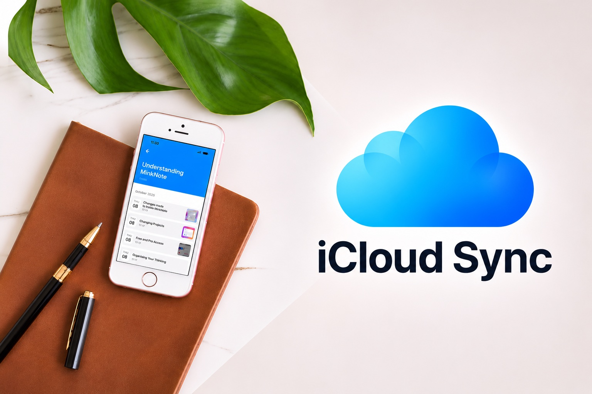
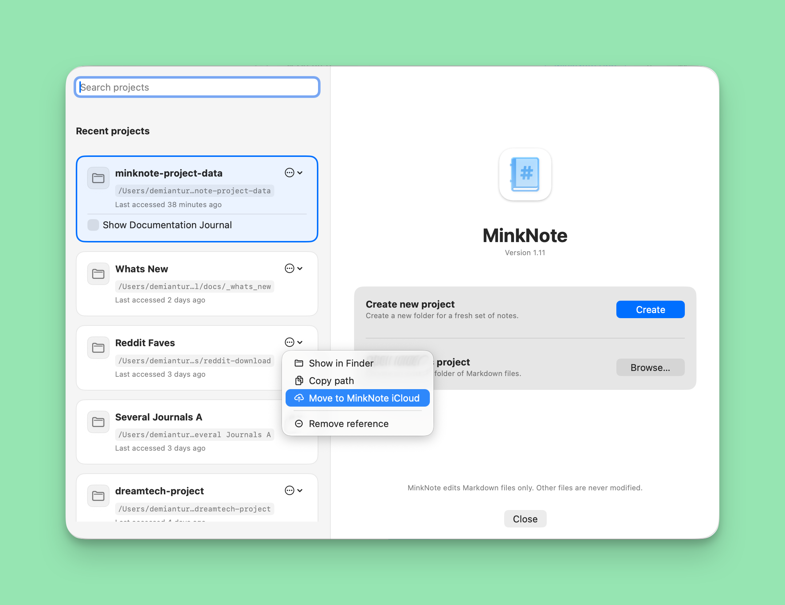
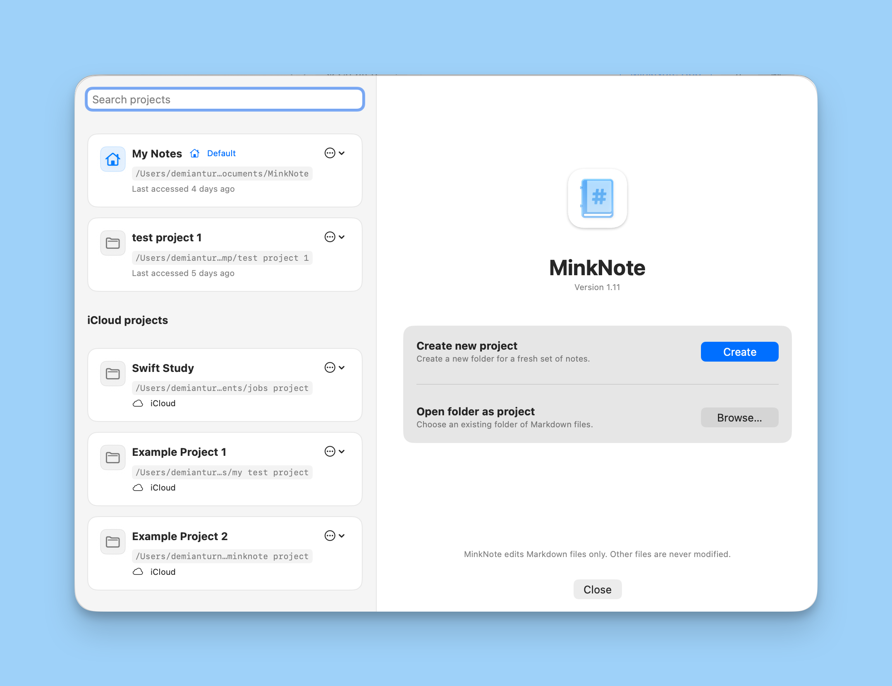

MinkNote 1.10 brings **iCloud sync for Pro users**. Keep a project in iCloud and the same notes are there on your Mac, iPhone and iPad. They're still ordinary Markdown files, stored in your own private iCloud storage.

iCloud is optional. Local projects stay on your Mac unless you choose to move them.

## Move a Project to iCloud in One Click

You don't need to copy files across or set up your notes again. On the Mac, **Move to iCloud** moves an existing local project into iCloud, including its folders, notes and attachments.

1. Switch to a different project. A project can't be moved while it's open.
2. Open the project switcher at the bottom of the sidebar.
3. Click the project's options button (•••) and choose **Move to iCloud**.

*Here I'm moving the minknote-project-data project to iCloud.*

When the move finishes, the project appears in the **iCloud** section of the project switcher.

How long it takes depends on the size of the project and your connection. In my testing, most moves finished within a few seconds on ordinary home broadband.

The built-in *My Notes* project stays on your Mac and can't be moved.

## Your Notes, on Every Device

Once a project is in iCloud, open MinkNote on your iPhone or iPad and it's ready to use. You can read, edit and create notes wherever you are.

This is the first mobile release. The core experience works well, but some Mac features haven't reached mobile yet and there are a few known issues.

I'm especially pleased with how well syncing works. Create a note on your Mac and it shows up on your iPhone within seconds. Edit something on your iPad and your Mac has the change just as quickly.

If the same note is edited on two devices, MinkNote picks up the incoming changes for you. If both copies have been changed, you choose which to keep: your local edits or the version from the other device.

The aim is simple: **your notes go where you go, and you don't have to think about syncing.**

## Learn More

The [Use iCloud with MinkNote](https://muse23.com/apps/minknote/docs/understanding-minknote/use-icloud-with-minknote/) guide covers what you need before you start, how to open projects on each device, and what to do if a note hasn't appeared yet.

## Get MinkNote 1.10

Download it now from the [App Store](https://apps.apple.com/app/minknote/id6755822706).
