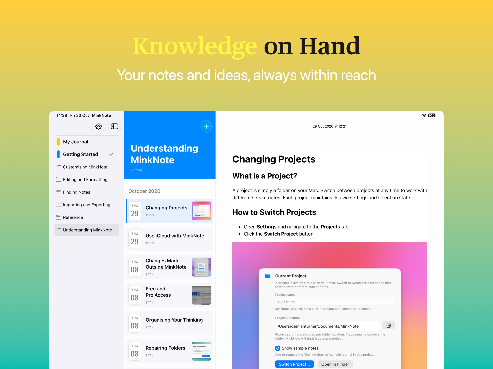
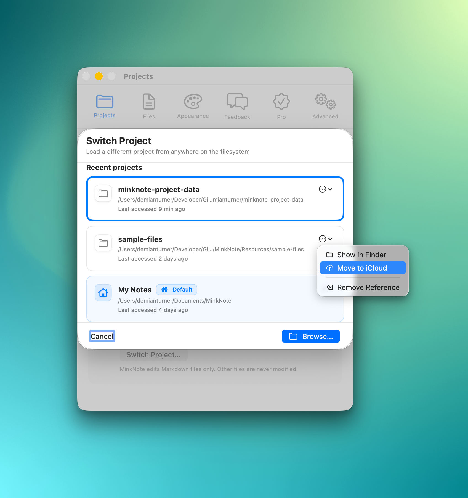
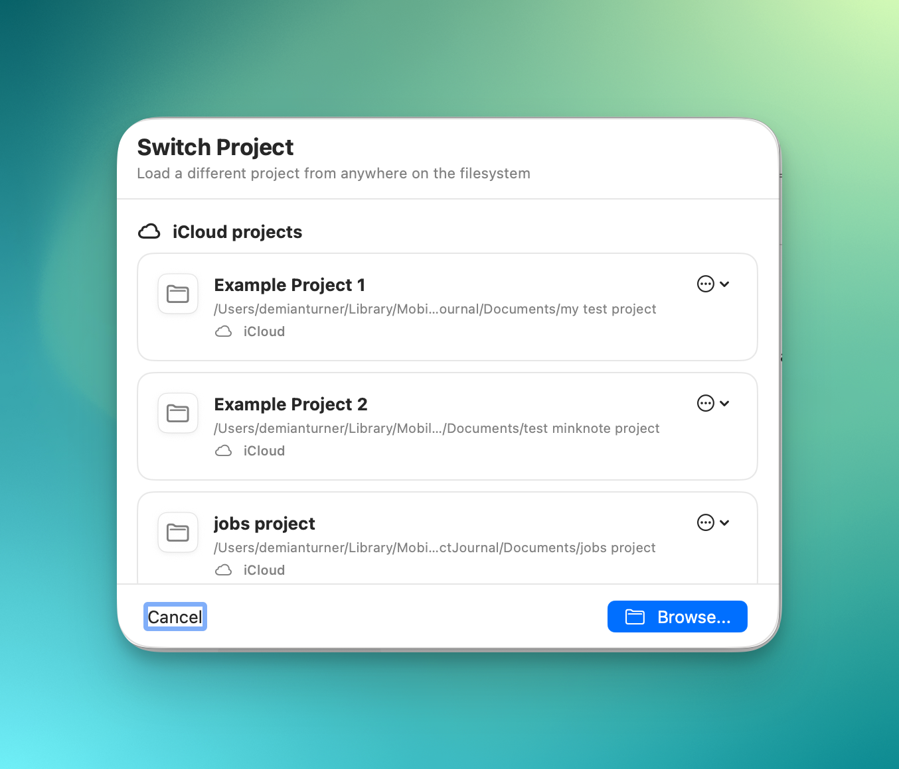

It's taken longer than expected to get through Apple's approval process, but I'm excited to announce that **MinkNote is finally available on iPhone and iPad!**

Release 1.10 brings MinkNote to three new devices:

* iPhone
* iPhone Duo
* iPad

And there's another major addition: **iCloud syncing for Pro users**, making it possible to work with the same notes across your Mac, iPhone and iPad.

## Move to iCloud

One of the biggest additions to the Mac app in this release is **Move to iCloud**.

If you're a Pro user, you can now move an existing local project into your private iCloud storage with just one click. There's no need to manually copy files or recreate your notes.

You'll find this option in the Mac app's project switcher.

To move a project:

1. Open the project switcher.
2. Find a local project that isn't currently open.
3. Open its options menu and select **Move to iCloud**.

A couple of things to keep in mind:

* The project must not already be in iCloud.
* You cannot move the default *My Notes* project.
* You cannot move the currently active project. Switch to another project first.

In this example, I'm moving the *sample-files* project to iCloud.

Once the transfer is complete, your project will appear in the iCloud section of the project switcher.

How long does it take? That depends on the size of your project and your internet connection. In my testing, most transfers have taken just a few seconds on a typical broadband connection.

Once your project is in iCloud, you can access it from MinkNote on your other devices.

## Read, Edit and Create Notes on the Go!

With your projects in iCloud, you can now read, edit and create notes on your iPhone or iPad.

This is the first mobile release, so while the core experience is working well, some Mac features are still being brought across and there are a few known issues.

What I'm particularly pleased with is how well syncing works.

Create a note on your Mac and it appears on your iPhone within seconds. Make changes on your iPad and they'll be reflected on your Mac just as quickly.

Even when you're editing the same note on two devices, MinkNote handles incoming changes. If both versions have been modified, you'll be given the choice of keeping your local changes or accepting the version from the other device.

The goal is simple: **your notes should follow you between devices without you having to think about syncing.**

## What's Coming Next?

The mobile apps don't yet have complete feature parity with the Mac version.

The following features are currently unsupported on iPhone and iPad, but are planned for upcoming releases:

* Create journals
* Create projects
* Create links
* Add images
* Create and browse by tags
* Add notes to favourites
* Pin notes

My priority has been getting the fundamentals right first: opening projects, reading and editing notes, creating content and keeping everything in sync.

The remaining features will follow as the mobile apps mature.

## A Work in Progress

I've been working on mobile support for several months, with extensive daily testing across devices.

The core functionality is working well, particularly moving projects to iCloud, editing notes across devices and creating new content on mobile.

**That said, this is the first mobile release, and there are a few rough edges.**

Two issues you might encounter:

* **Selecting a note:** Occasionally, you may need to tap a note twice before it opens.
* **Creating a note:** Sometimes the **+** button doesn't respond on the first attempt.

These are known issues that I'm working to resolve.

Importantly, I haven't encountered any data loss during my testing. That includes migrating projects to iCloud, editing notes across multiple devices and creating new content on mobile.

Nevertheless, as with any new release involving cloud syncing, I'd recommend keeping a backup of important notes.

## Give It a Try!

Bringing MinkNote to iPhone and iPad is a big milestone for the app.

MinkNote started as a Mac-first Markdown notes app built around a simple idea: **your notes are yours, stored as ordinary files, without being locked into a proprietary system.**

That philosophy hasn't changed. iCloud simply makes those files accessible across your Apple devices.

There's still work to do, and I'll be improving the mobile experience over the coming releases.

If you try the new apps, I'd be very interested to hear how you get on, particularly if you encounter any issues or have suggestions for what I should tackle next.

## Download the latest version of the app
On the [App Store](https://apps.apple.com/app/minknote/id6755822706)
