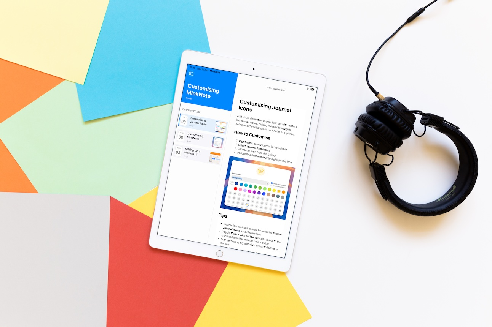
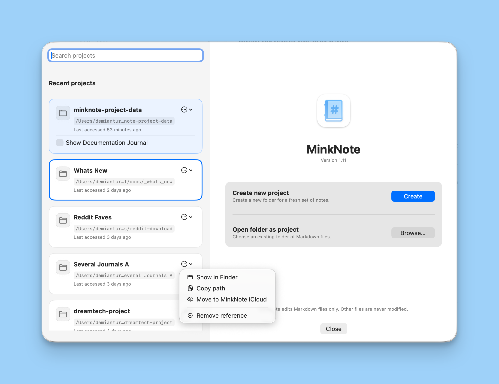
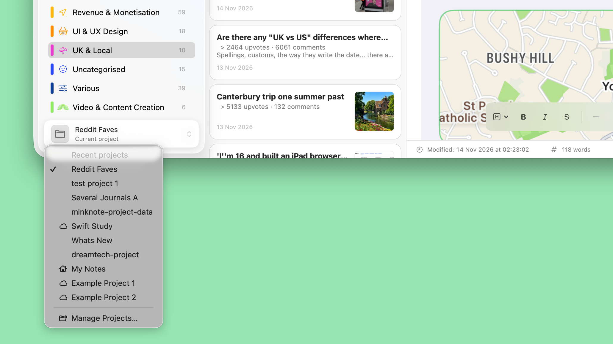
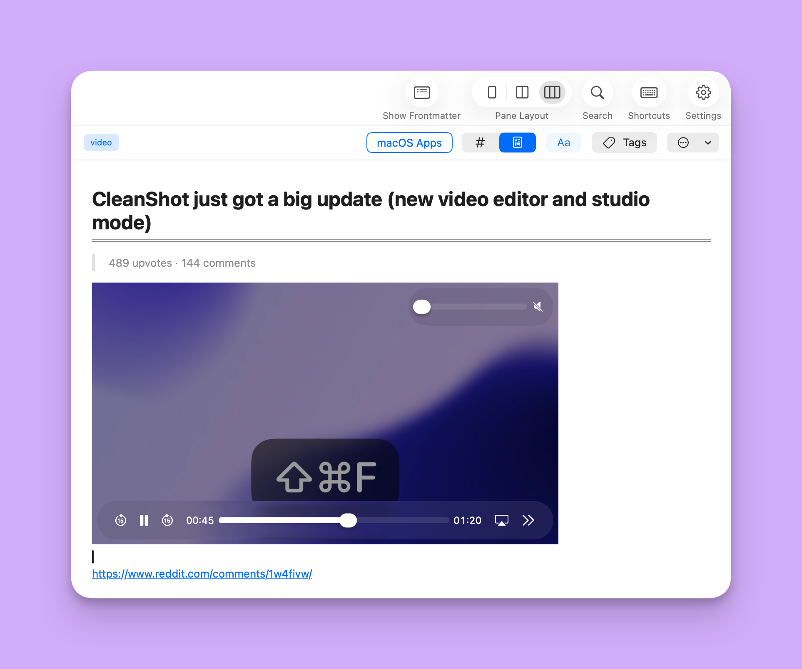
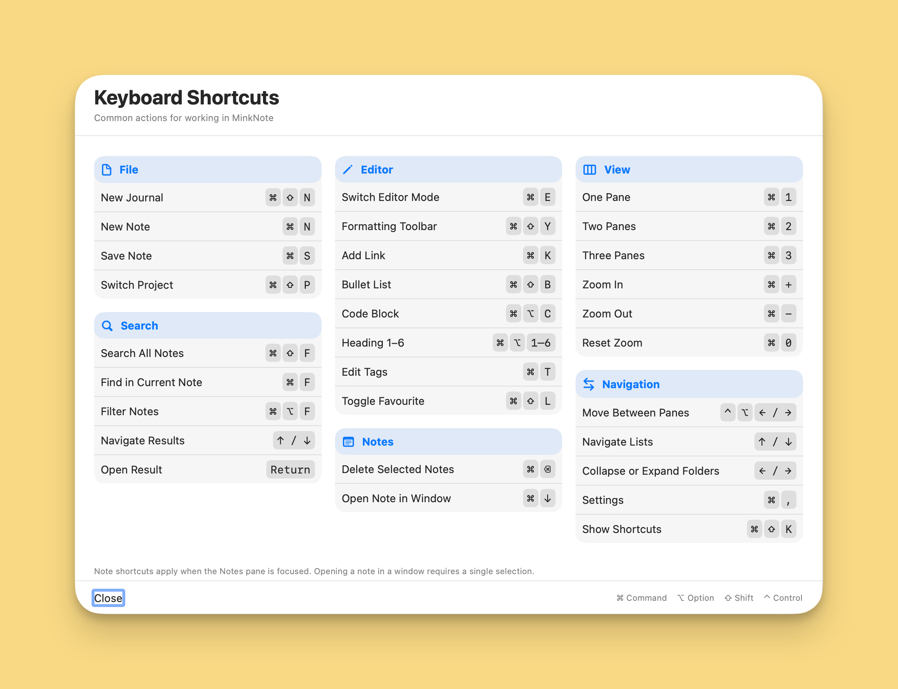

**MinkNote is now on iPhone and iPad!**

Release 1.11 is the biggest update yet. Your notes now go wherever you do, on:

* iPhone
* iPhone Duo
* iPad

## Your Notes, Wherever You Are

The notes you've been writing all day on your Mac are now in your pocket. Read them on the train, tidy them up in a queue, or go back over the day's work from the sofa with your iPad. Everything syncs through iCloud, so you can pick up where you left off.

## Built to Be Reliable

I've been building and testing the mobile apps for several months, and they've been fast and reliable throughout.

Syncing has been tested thoroughly: moving projects to iCloud, editing the same notes on several devices, and writing new notes on iPhone and iPad. **Every note has stayed intact and up to date across every device.**

As with any app that syncs through the cloud, keeping regular backups of your important notes is good practice.

## What's Coming Next on Mobile

I focused on the essentials first: opening projects, reading and editing notes, creating new notes and keeping everything in sync. These are solid now.

Some Mac features aren't on iPhone and iPad yet. They're planned for upcoming releases:

* Create journals
* Create projects
* Create links
* Add images
* Create and browse by tags
* Add notes to favourites
* Pin notes

## Same Philosophy, More Devices

MinkNote started as a Mac-first Markdown app built on one idea: **your notes are yours, stored as ordinary files, never locked into a proprietary system.**

That hasn't changed. iCloud simply puts those same files on all your Apple devices.

This is just the start for MinkNote on mobile. If you try the new apps, I'd love to hear how you get on, especially if you run into problems or have ideas for what I should build next.

## Also New in 1.11

### A Faster Way to Switch Projects

The new project navigator gets you to any project in a few keystrokes. From one panel you can:

* Create a new project from scratch, or from an existing folder of Markdown notes
* Move local projects to iCloud (Pro users)
* Search all your projects

Or switch projects straight from the menu in the sidebar:

### Reddit Videos, Right in Your Notes

Reddit videos now play inline in your notes:

1. Add one with a simple shortcode, just like embedded YouTube videos
2. Videos autoplay muted, so they won't interrupt you

See the [full documentation](https://muse23.com/apps/minknote/docs/editing-and-formatting/embedding-youtube-and-reddit-videos/).

### Every Shortcut at a Glance

The new Keyboard Shortcuts panel shows every shortcut in one place, a click away.

## Get MinkNote 1.11

Download it now on the [App Store](https://apps.apple.com/app/minknote/id6755822706).

 
 
