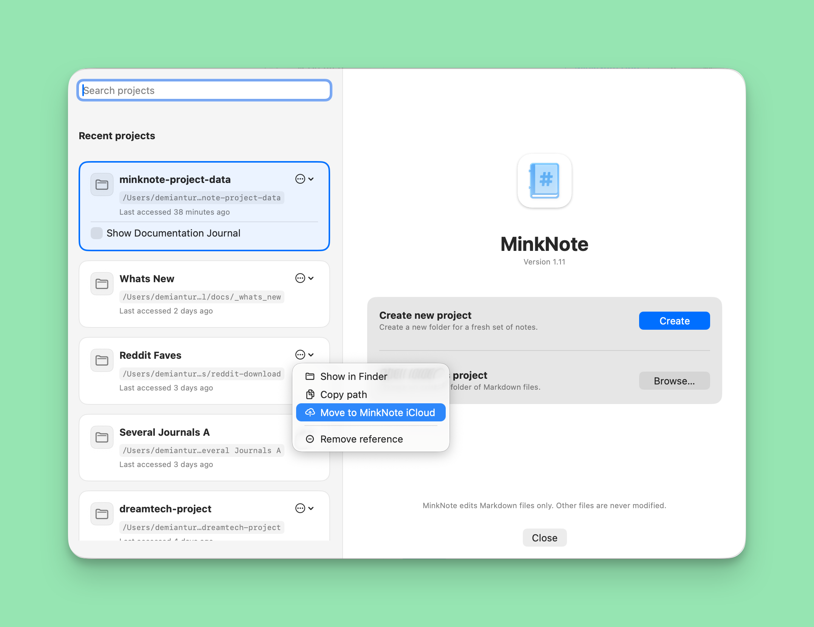
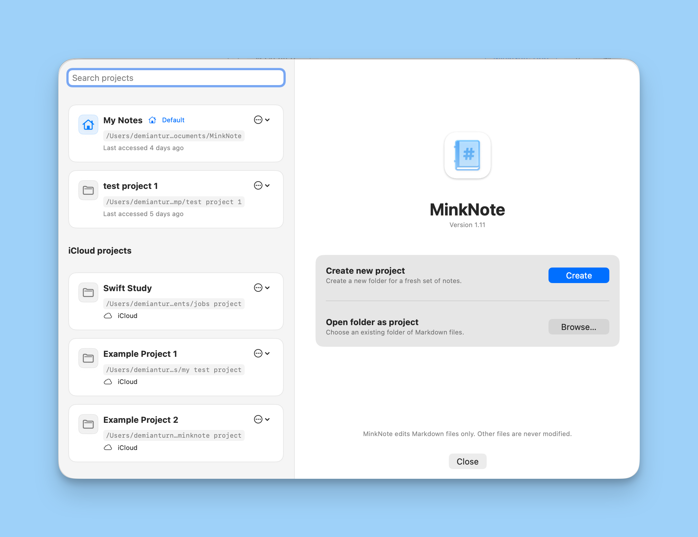

Keep a project in MinkNote’s iCloud folder to open its journals, notes and images on your Mac, iPhone and iPad. Your notes remain ordinary Markdown files.

iCloud is optional. Projects stored locally stay on your Mac unless you move them.

## Before you start

On each device, make sure you have:

* MinkNote installed, with Pro access for iCloud projects.
* The same Apple Account signed in, with iCloud Drive turned on.
* An internet connection and enough free iCloud storage for your project.

## Move a project to iCloud on Mac

1. Close your current project by switching to another one (a project must be closed before it can move).
2. Use the project switcher at the bottom of the sidebar.
3. Click **Switch Project**.
4. Click the project’s options button (the circle with three dots), then choose **Move to iCloud** to start the move.
5. Click **Okay** and the project move will continue to happen in the background.

MinkNote moves the whole project, including its folders, notes and attachments, into its iCloud folder. The project appears under **iCloud projects** when the move finishes. Uploading may continue after the move is complete.

The built-in **My Notes** project stays on your Mac and can’t be moved this way. If a folder with the same name already exists at the destination, MinkNote stops rather than replacing it.

Projects stored elsewhere in iCloud Drive can also use **Move to iCloud** to move into MinkNote’s iCloud folder.

## Open the project on another device

**On another Mac:** Open **Sidebar > Project Switcher > Switch Project**, then choose the project under **iCloud projects**.

**On iPhone:** Tap the folder button to open **Projects**, then choose the project under **iCloud**.

**On iPad:** Tap the current project at the bottom of the sidebar to open **Projects**, then choose the project under **iCloud**.

On iPhone and iPad you can read, create and edit notes. Your changes are saved and sync back to your other devices through iCloud.

Only projects in MinkNote’s own iCloud folder appear in this list automatically. Use **Move to iCloud** on your Mac to prepare an existing project for your other devices.

## While your notes are syncing

A project may appear before all its notes and images have downloaded. More items can appear as iCloud makes them available. Open a note to load its contents; images may take a little longer.

On Mac, MinkNote waits for a cloud note’s current contents before letting you edit it. A loading indicator doesn’t mean the whole project has finished syncing.

After saving on your Mac, allow time for iCloud to upload your changes before opening the note on another device. If a note changes elsewhere while you have unsaved edits on Mac, MinkNote lets you review the change. See [Changes made outside MinkNote](/apps/minknote/docs/understanding-minknote/changes-made-outside-minknote/).

## If a project or note hasn’t appeared

MinkNote checks for new files automatically. If something is still missing:

* Check your internet connection, Apple Account, iCloud Drive settings and Pro access.
* On Mac, open **Switch Project** and click **Refresh**. If iCloud is unavailable, click **Retry** when it appears.
* On iPhone or iPad, open **Projects** and pull down to refresh the list.
* If a note or image shows **Refresh** or **Retry**, choose it to try loading that item again.

Large projects and attachments can take longer to arrive. You can keep using your local projects while you wait.

## If a move is interrupted

Open the project switcher again and follow the message shown. Choose **Retry** or **Retry recovery** if offered. You can also find **Retry recovery** in **Settings > Advanced > Project Recovery**.

If the files have already moved, retrying finishes the remaining setup without moving them again. If MinkNote can’t confirm where the project is, it keeps the folders in place and leaves the project unavailable until recovery succeeds. Leave those folders in place while recovery is pending.

## Related guides

* [Changing Projects](/apps/minknote/docs/understanding-minknote/changing-projects/)
* [Free and Pro Access](/apps/minknote/docs/understanding-minknote/free-and-pro-access/)
